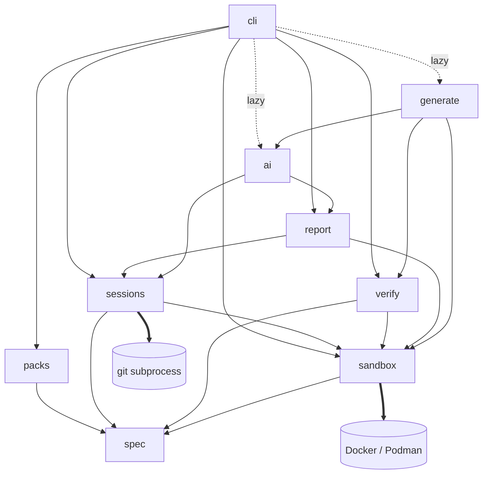

# Architecture

Patchground is a single Python package (`src/patchground/`) exposed as one CLI. Docker does the
isolation, git does the history, and the LLM is a pluggable leaf that the core loop never depends on.
The user only ever touches the workspace; everything else runs with no network (after the image
build) and no API key.

## Topology



| Module | Owns | Spec |
| --- | --- | --- |
| `cli` | Commands, terminal and `--json` output, consent prompts. No business logic. | `patchground-cli` |
| `spec` | Manifest models, loading, schema export. Depends on nothing internal. | `patchground-spec` |
| `packs` | Resolving a challenge reference to a folder and its trust level; installing packs. | `patchground-packs` |
| `sessions` | Session lifecycle, workspace repo, event log, check orchestration. | `patchground-sessions` |
| `sandbox` | Every interaction with the container engine. | `patchground-sandbox` |
| `verify` | The verification contract run against a challenge folder. | `patchground-verify` |
| `report` | Deterministic verified outcomes from the event log and git history. | `patchground-report` |
| `ai` | Provider abstraction, versioned prompts, the debrief interviewer. Experimental; no SPEC yet. | — |
| `generate` | Challenge generation pipeline. Starts as a script in `experiments/generate/`, outside the package; no SPEC yet. | — |

Edges not drawn above are forbidden. In particular: nothing below `cli` imports `cli`; nothing in the
core imports `ai` or `generate`; only `sandbox` imports the Docker SDK; only `sessions` runs git on
workspaces (others read git data through `sessions`), `packs` runs it only to clone and fetch pack
sources, and `verify` runs only `git apply` on a throwaway copy of a challenge's `workspace/` (never
a repo the user owns, never with repository config a challenge could supply). `cli` reaches `sandbox` only for `doctor`'s engine probe.

## Cross-cutting decisions

- **The contracts are the rules.** Behavior that spans modules is fixed in the contract specs under
  `docs/contracts/`; modules implement them and never restate them:
  `patchground-contract-challenge-format`, `patchground-contract-execution`,
  `patchground-contract-verification`, `patchground-contract-cli`, `patchground-contract-feedback`,
  `patchground-contract-security`.
- **Two-phase execution.** Building an image may use the network; running checks never does. See
  `patchground-contract-execution`.
- **AI is a lazy leaf.** `ai` is imported only inside the AI commands, and its SDKs ship as the
  optional `patchground[ai]` extra. A core install without the extra must import and run every
  non-AI command. The `ai` module exposes one `Provider` protocol (`complete`, `estimate_tokens`);
  Anthropic and Ollama come first, an OpenAI-compatible adapter after. Prompts are versioned files in
  `patchground/ai/prompts/*.md`. Keys come from environment variables only.
- **Git through a thin subprocess wrapper,** not a library: git is already required and the CLI's
  behavior is easier to predict.
- **The user's git state is sacred.** Patchground never changes the workspace's HEAD, branches, index
  or staging area. Internal history uses `refs/patchground/*` written through a temporary index.
- **Glossary terms are exact.** Identifiers, messages and docs use the terms in `patchground-goal`.

## Storage

```
~/.patchground/
├── config.toml           # defaults (provider, model, editor); never API keys
├── packs/<pack>@<sha>/   # installed packs, read-only
└── cache/                # image digests, verification results
~/patchground/sessions/<date>-<challenge>/
├── workspace/            # the user's git repo
└── .session/             # session.json, events.jsonl, original/, report.md, AI payloads
```

Sessions always live under `~/patchground/sessions/`; the layout of `.session/` is owned by
`patchground-sessions`.

## Platforms

macOS and Linux with Docker (or Podman through its Docker-compatible socket) and git. Windows only
through WSL2 + Docker Desktop; `pgnd doctor` points Windows users there.

## Repositories

- `patchground/patchground` — this repo: the CLI, the format, schemas (`schema/`), scaffolds
  (`templates/`), tiny test challenges (`examples/`), docs.
- `patchground/patchground-core` — the official, curated pack.
- `patchground/validate-action` — a GitHub Action that runs `pgnd validate` on changed challenges.

## Testing

Unit tests per module; tests that need a container engine are marked `@pytest.mark.docker`, and CI
sets `PATCHGROUND_REQUIRE_DOCKER=1` so they fail rather than skip without an engine. ruff for lint,
mypy strict on `spec`, `verify`, `report`, `sessions` and `sandbox` (the safety boundary). The challenges in
`examples/` must pass `pgnd validate` in CI; their `verification.json` is gitignored, because a
locally built image id means nothing on another machine and CI re-validating every push is the
proof. Broken challenges, one per failing step, live in `tests/fixtures/`.
