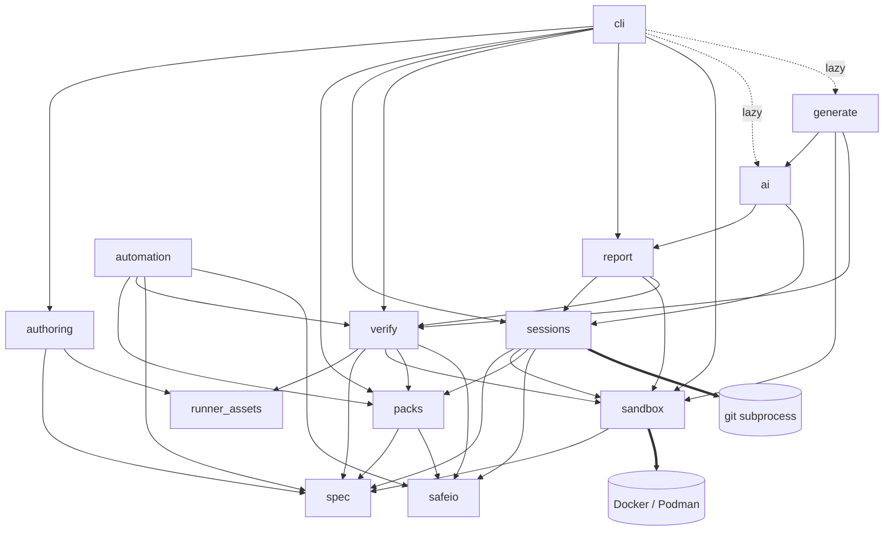

# Architecture

Patchground is a single Python package (`src/patchground/`) exposed as one CLI. Docker does the
isolation, git does the history, and the LLM is a pluggable leaf that the core loop never depends on.
The user only ever touches the workspace; everything else runs with no network (after the image
build) and no API key.

## Topology



| Module | Owns | Spec |
| --- | --- | --- |
| `cli` | Commands, terminal and `--json` output, consent prompts. No business logic. | `patchground-cli` |
| `authoring` | Safe local scaffolding from packaged runnable templates; no execution. | `patchground-authoring` |
| `automation` | Committed changed-challenge selection and safe aggregate results for the in-repository Action. | `patchground-automation` |
| `runner_assets` | Canonical portable container harness and locked toolchain bytes; no host execution. | `patchground-runner-assets` |
| `spec` | Manifest models, loading, schema export. Depends on nothing internal. | `patchground-spec` |
| `packs` | Pinned distribution, immutable content, resolution and execution consent. | `patchground-packs` |
| `safeio` | Shared descriptor-safe filesystem access and Git executable selection. | `patchground-safeio` |
| `sessions` | Session lifecycle, workspace repo, event log, check orchestration. | `patchground-sessions` |
| `sandbox` | Every interaction with the container engine. | `patchground-sandbox` |
| `verify` | The verification contract run against a challenge folder. | `patchground-verify` |
| `report` | Immutable verified outcomes from captured files, events and container probes. | `patchground-report` |
| `registry/` | Public index of community packs: scheduled discovery by GitHub topic, re-validation in CI, `index.json`/`status.json`. A script beside the package, not inside it. | `patchground-registry` |
| `ai` | Optional AI coaching. Deferred from launch after a bounded local evaluation (`docs/evaluations/ai-debrief-smoke.md`); not in the package. | — |
| `generate` | Challenge generation experiment. Deferred from launch; not implemented. | — |

Edges not drawn above are forbidden. In particular: nothing below `cli` imports `cli`; nothing in the
core imports `ai` or `generate`; only `sandbox` imports the Docker SDK; only `sessions` runs git on
workspaces (others read git data through `sessions`), `packs` runs isolated Git retrieval and raw
object inspection without loading source configuration, and `verify` runs only `git apply` on a
throwaway copy of a challenge's `workspace/` (never a repo the user owns, never with repository config a challenge could supply). `report` uses
`verify` only for shared pure pytest/TypeScript recognition and static-analysis primitives; submission execution
still goes through `sandbox`, and sessions never imports report. `cli` reaches `sandbox` only for `doctor`'s engine probe.

## Cross-cutting decisions

- **The contracts are the rules.** Behavior that spans modules is fixed in the contract specs under
  `docs/contracts/`; modules implement them and never restate them:
  `patchground-contract-challenge-format`, `patchground-contract-execution`,
  `patchground-contract-verification`, `patchground-contract-cli`, `patchground-contract-feedback`,
  `patchground-contract-security`.
- **Two-phase execution.** Building an image may use the network; running checks never does. See
  `patchground-contract-execution`.
- **Runtime TypeScript, not type checking.** A pinned Vitest harness normalizes identities and
  withholds JUnit on runner-wide faults without changing global sandbox exit semantics. Shared
  Tree-sitter parsing supplies bounded tampering/regression evidence without importing authored
  code. Canonical `runner_assets` bytes are copied into portable authored environments; neither
  `authoring` nor `verify` executes those assets on the host.
- **AI is a lazy leaf.** `ai` is imported only inside the AI commands, and its SDKs ship as the
  optional `patchground[ai]` extra. A core install without the extra must import and run every
  non-AI command. The `ai` module exposes one `Provider` protocol (`complete`, `estimate_tokens`);
  Anthropic and Ollama come first, an OpenAI-compatible adapter after. Prompts are versioned files in
  `patchground/ai/prompts/*.md`. Keys come from environment variables only.
- **Git through a thin subprocess wrapper,** not a library: git is already required and the CLI's
  behavior is easier to predict.
- **The user's git state is sacred.** Patchground never changes the workspace's HEAD, branches, index
  or staging area. Checkpoint objects and `refs/patchground/*` live in private session-owned Git
  storage, built through isolated temporary indexes/repositories. Ignore configuration is read only
  as data; configured tools, hooks and filters never execute. Initial/check checkpoints are optional;
  failure cannot invalidate test evidence. There is no periodic capture or snapshot restoration.
- **Glossary terms are exact.** Identifiers, messages and docs use the terms in `patchground-goal`.

## Storage

```
~/.patchground/
├── config.toml           # defaults (provider, model, editor); never API keys
├── registry.json         # pinned versions, active revision and exact-version consent
├── packs/<pack>@<sha>/    # installed packs, read-only
└── cache/                # image digests, verification results
~/patchground/sessions/<date>-<challenge>/
├── workspace/            # the user's git repo
└── .session/             # session.json, events.jsonl, original/, submission/, AI payloads
```

Sessions always live under `~/patchground/sessions/`; the layout of `.session/` is owned by
`patchground-sessions`.

## Platforms

macOS and Linux with Docker (or Podman through its Docker-compatible socket) and git. Windows only
through WSL2 + Docker Desktop; `pgnd doctor` points Windows users there.

## Public site boundary

`patchground.dev` is a public documentation and challenge-catalog surface, not a hosted runner.
Challenge execution, session state and verified outcomes stay local. Published catalog data is an
allowlist of public challenge metadata and tickets, never session data, hidden checks, reference
solutions or credentials. The standalone `web/` module (`patchground-web`) owns the product-first
static homepage, with CLI installation, real-world practice, public guides and challenge tickets. It has no dependency on the CLI; its catalog is
generated from an allowlist of public `challenge.yaml` fields plus the community index in
`registry/index.json` (see `patchground-web`, `patchground-registry`), and its build copies an
explicit allowlist of public assets. Community packs reach the site by *publish and appear*: the
author tags their repository, CI re-validates it, no pull request (`patchground-registry`). Hosting remains a
separate delivery decision. DNS, production deployment, package publication and releases require
approval at publication.

## Repositories

- `patchground/patchground` — this repo: the CLI, the format, schemas (`schema/`), scaffolds
  (`src/patchground/authoring/templates/`), test challenges (`examples/`), docs, and the reusable
  validation Action (`action.yml`, `patchground-automation`). The Action uses the same verifier with
  explicit execution consent and disposable committed inputs, never mutating the checkout.
- `patchground/patchground-core` — the official, curated pack.
The validation Action is versioned here with the CLI, superseding the separate-repository plan.

## Testing

Unit tests per module; tests that need a container engine are marked `@pytest.mark.docker`, and CI
sets `PATCHGROUND_REQUIRE_DOCKER=1` so they fail rather than skip without an engine. ruff for lint,
mypy strict on `spec`, `verify`, `report`, `sessions`, `authoring` and `sandbox` (the safety boundary). The challenges in
`examples/` must pass `pgnd validate` in CI; their `verification.json` is gitignored, because a
locally built image id means nothing on another machine and CI re-validating every push is the
proof. Broken challenges, one per failing step, live in `tests/fixtures/`.
